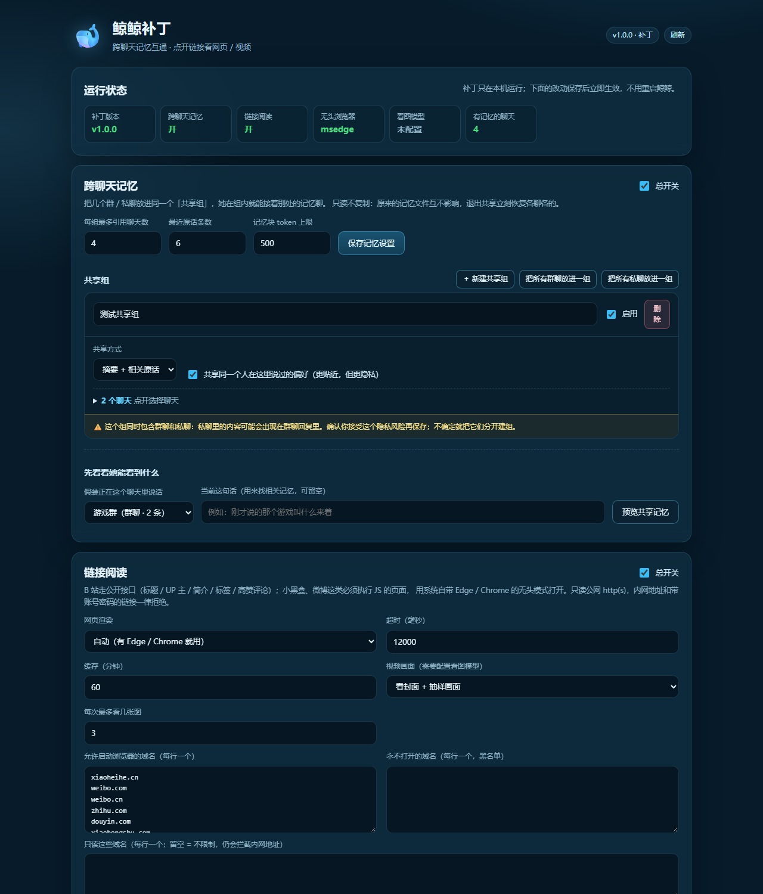

# 鲸鲸补丁 · 跨聊天记忆与链接阅读

> [!IMPORTANT]
> **这不是独立软件，单独下载本仓库没有任何作用。**
> 本仓库是 [鲸鲸 / Whale Girl](https://github.com/Banan1cee/whale_girl) 的外挂补丁，必须先安装基础软件：
> **<https://github.com/Banan1cee/whale_girl>**（Windows，4.0.x / 4.1.0）。
> 补丁不自带模型、不自带微信自动化、没有独立界面；它只给已经装好的鲸鲸加两个能力。

**一句话**：让鲸鲸在指定聊天之间记忆互通，并且能点开群友发的 B 站 / 小黑盒 / 网页链接看内容；
装好后启动器左侧会多一栏 **「补丁」**，网页控制台在 `http://127.0.0.1:8787/patch/`。

## 30 秒安装（3 步）

1. **先装基础软件**：从 <https://github.com/Banan1cee/whale_girl> 安装鲸鲸（当前推荐 4.1.0），确认能从启动器正常启动、登录微信。
2. **装补丁**：下载本仓库 ZIP → 解压 → 双击 `install.cmd`。
   安装器会自动找鲸鲸目录；找不到会弹窗让你选——选**包含 `server.js` 的那个文件夹**（不是补丁文件夹）。
3. **重启并打开**：**完全退出启动器**（托盘图标右键退出）再打开——新的一栏「补丁」才会出现；
   只点启动器里的「重启」通常只重启内核。然后打开 <http://127.0.0.1:8787/patch/>。

> 安装器主要做三件事：复制 `patch\` 到 `鲸鲸目录\whale-patch\`、在 `server.js` 第一行加一行加载语句、生成 `data\whale-patch.json`；
> 本体版本匹配时，再额外装一栏「补丁」启动器（原文件自动备份）。
> 卸载：双击 `uninstall.cmd`。
> 卡住了看图文教程：[docs/tutorial.md](docs/tutorial.md)。

## 它是什么 / 不是什么

| 是 | 不是 |
| --- | --- |
| 鲸鲸的**外挂补丁**，给已安装的鲸鲸加功能 | ❌ 不能单独运行的软件 |
| 给启动器加一栏「补丁」（本体 4.0.8.2 / 4.1.0 可选组件） | ❌ 不会替换/重装鲸鲸本体 |
| 只改 `server.js` 第一行，其余代码原样保留 | ❌ 不需要再装 Node、Python、数据库 |
| 零 npm 依赖，用鲸鲸自带的 Node / Python | ❌ 不是云服务，不上传聊天记录 |
| 管理页只在本机 `127.0.0.1` 访问 | ❌ 不暴露公网 |



---

## 它解决什么问题

鲸鲸原本的红线是「一个聊天只读自己的记忆」：

- 你在这个群刚说过的事，换个群 / 私聊她就完全不记得；
- 群友发的小黑盒、B 站链接，她要么无视，要么只能读到标题，读不到正文 / 视频信息。

这个补丁加了两件事：

### 1. 跨聊天记忆（可选、按组共享）

在管理页里把几个群 / 私聊放进同一个「共享组」，组内聊天可以互相看到：

- 对方的**会话摘要**（鲸鲸本来就会为每个聊天生成的 L2 记忆）；
- 和当前这句话相关的**最近原话**（关键词命中，不是全量搬运）；
- 可选：**同一个人**（uid 相同）在别的聊天里说过的偏好。

关键取舍：

- **只读，不复制**：原来每个聊天的记忆文件仍然独立，清空一个聊天不会误删别的；
- **随时可退**：关掉总开关或把聊天移出共享组，立刻回到「各聊各的」；
- **有预算**：每组最多带 `maxTokens`（默认 320 token），不会把 prompt 顶爆；
- **有边界提示**：告诉模型「这是共享来的记忆，别把 A 群的事说成 B 群刚发生的，别抖隐私」。

### 2. 真正点开链接（网站 / 视频）

- **B 站**：走公开接口拿标题、UP 主、时长、简介、标签、播放/点赞数据、**高赞评论**；
  再用官方故事板裁几张视频画面，交给看图模型——她能看到「封面 + 几张画面」，而不是只看 og:description。
- **小黑盒 / 微博 / 知乎 / 抖音 / 小红书**：这些页面必须执行 JS 才看得到内容。
  补丁调用系统自带 **Edge / Chrome 无头模式**渲染，再把正文和评论抽出来。
- **普通网页 / 公众号文章**：直接抓 HTML，按 `article` / 正文 class / 段落抽正文。
- **安全**：只读公网 http(s)；本机 / 内网 / 云元数据地址、带账号密码的 URL、非 80/443 端口一律拒绝；
  支持域名白名单 / 黑名单；浏览器只对白名单内的站点启动；不携带任何 Cookie。

读到的内容会在 1 小时（可调）内缓存，不会每条消息都重新抓。

> 关于 4.1 的「社区插件」：插件市场目前面向 WebAssembly 工具 / 人设包，不能改记忆管线或
> `links.describeLink`，所以本补丁仍是服务端外挂 + 可选启动器页；等官方开放相应接口再迁移。
> 详见 [docs/updates.md](docs/updates.md)。

---

## 安装

### 前置条件

- Windows 10/11；
- 已安装鲸鲸 4.0.x / 4.1.0（安装目录里能看到 `server.js`、`src\`、`runtime\`）：
  **<https://github.com/Banan1cee/whale_girl>**；
- 小黑盒这类动态页需要系统里有 **Microsoft Edge**（Win10/11 自带）或 Chrome；
- 想让链接「看视频画面」，需要在鲸鲸里配好**看图模型**的 Key（默认智谱 `glm-4.6v-flash` 有免费额度）。

### 一键安装（推荐）

1. 下载本仓库 ZIP，**解压到任意目录**（不要在压缩包里直接运行）；
2. 双击 `install.cmd`；
3. 安装器自动检测鲸鲸目录；检测不到会弹窗，选包含 `server.js` 的文件夹；
4. 看到 `Installed successfully` 后，**完全退出启动器再打开**（托盘右键退出）；
5. 打开 <http://127.0.0.1:8787/patch/>，或点启动器左侧的「补丁」。

安装器会备份 `server.js`（`server.js.whale-patch.bak`），然后复制补丁、加一行挂钩、做语法检查、生成配置。
重复运行 `install.cmd` 就是更新补丁，不会重复加挂钩。

如果本体是 **4.0.8.2 或 4.1.0**，安装器还会给启动器加一栏 **「补丁」**（替换前备份
`WhaleLauncher.exe.whale-patch.bak`）。启动器重启后，左侧最后一项就是「补丁」，
里面和网页控制台是同一套功能。

> 本体更新后，`server.js` 的挂钩和启动器可能被官方覆盖：**重新运行一次 `install.cmd`** 即可，
> 补丁配置和聊天记忆不会丢。详见 [docs/updates.md](docs/updates.md)。

默认只启用「全部群聊」共享组，私聊组停用；想改就到管理页 / 启动器「补丁」页里勾选。

### 桌面快捷方式（安装时可选）

安装最后会问一句：

```text
Create desktop shortcuts (install/update + patch console)? [Y/n]
```

- 选 **Y**：创建
  - `鲸鲸补丁-安装或更新` → 当前解压目录的 `install.cmd`
  - `鲸鲸补丁-控制台` → `http://127.0.0.1:<端口>/patch/`
- 选 **n**：不创建，仍可用解压目录里的 `install.cmd` 手动更新。

> 快捷方式指向的是**你解压补丁的那个文件夹**。以后更新时不要删它；如果删了，
> 重新下载最新 ZIP 解压即可，安装器会重新创建快捷方式。

### 没有快捷方式时怎么更新

不要去找“控制面板”或系统更新，按这个来：

1. 打开 <https://github.com/7ather-LX/whale-girl-patch/releases/latest>；
2. 下载最新的 `whale-girl-patch-vX.Y.Z.zip`；
3. 解压到任意固定目录（例如 `D:\WhaleGirlPatch`）；
4. 双击解压目录里的 `install.cmd`；
5. 完全退出鲸鲸启动器，再打开 → 点「启动」。

补丁配置、聊天记忆、共享组都在 `鲸鲸目录\data\` 里，更新不会丢。

### 命令行安装（可选）

```powershell
powershell -ExecutionPolicy Bypass -File .\install.ps1 -AppRoot "D:\WhaleGirl"
```

想装完就默认「全部群聊互通」：

```powershell
powershell -ExecutionPolicy Bypass -File .\install.ps1 -AppRoot "D:\WhaleGirl" -EnableAllShared
```

不想替换启动器（只用网页控制台）：

```powershell
powershell -ExecutionPolicy Bypass -File .\install.ps1 -AppRoot "D:\WhaleGirl" -SkipLauncher
```

静默安装时指定是否创建桌面快捷方式：

```powershell
# 创建
powershell -ExecutionPolicy Bypass -File .\install.ps1 -AppRoot "D:\WhaleGirl" -CreateShortcuts

# 不创建
powershell -ExecutionPolicy Bypass -File .\install.ps1 -AppRoot "D:\WhaleGirl" -NoShortcuts
```

### 手动安装（不想跑脚本）

1. 把本仓库的 `patch\` 整个复制到 `鲸鲸目录\whale-patch\`；
2. 编辑 `鲸鲸目录\server.js`，在**第一行**加：

```js
require('./whale-patch').install();
```

3. 重启鲸鲸；
4. 配置写在 `鲸鲸目录\data\whale-patch.json`，也可以直接打开 <http://127.0.0.1:8787/patch/> 配。

---

## 配置

### 管理页

打开 `http://127.0.0.1:8787/patch/`：

- **运行状态**：补丁版本、共享记忆开关、链接阅读开关、无头浏览器 / 看图模型是否可用；
- **跨聊天记忆**：新建共享组 → 勾选聊天 → 选择「摘要 + 原话 / 只要摘要 / 只要原话」→ 保存；
- **链接阅读**：开关、超时、缓存、是否看视频画面、浏览器域名白名单 / 黑名单；
- **试读一个链接**：填 URL 点「读取」，能看到模型实际会收到的那段文字；
- **预览共享记忆**：选一个聊天，假装在那儿说话，看看她这轮能看到什么。

### 配置文件 `data/whale-patch.json`

```jsonc
{
  "enabled": true,
  "sharedMemory": {
    "enabled": true,
    "maxTokens": 320,        // 每轮共享记忆的 token 上限
    "maxSiblings": 4,        // 每组最多引用几个聊天
    "maxRecentLines": 6,     // 最多引用几条最近原话
    "scopes": [
      {
        "id": "family",
        "name": "家人",
        "mode": "both",       // both | summary | recent
        "match": "any",       // any = 按 chats 列表；group = 所有群聊；private = 所有私聊
        "enabled": true,
        "sharePeople": false, // 是否共享同一个人在其他聊天里的偏好
        "chats": [
          "wechat:g:123456@chatroom",
          "wechat:u:wxid_xxx"
        ]
      }
    ]
  },
  "links": {
    "enabled": true,
    "timeoutMs": 12000,
    "cacheMinutes": 60,
    "browser": "auto",       // auto | off | 绝对路径
    "browserDomains": ["xiaoheihe.cn", "weibo.com", "weibo.cn", "t.cn", "zhihu.com", "douyin.com", "xiaohongshu.com", "xhslink.com", "kuaishou.com"],
    "allowDomains": [],      // 非空 = 只读这些站
    "denyDomains": [],
    "videoVision": true,
    "maxVisionImages": 3,
    "maxBytes": 1200000
  }
}
```

`chats` 填聊天 key。管理页会自动列出；也可以看 `鲸鲸目录\data\memory\chats\<hash>\meta.json` 里的 `chatId`：

- 群：`wechat:g:<群 ID>@chatroom`
- 私聊：`wechat:u:<wxid>`
- `"chats": ["*"]` 表示全部聊天（含以后新建的）

共享组只认**第一个**包含该聊天的启用组；一个聊天不要同时放进多个组（管理页会把「已在别组」标出来）。

`match` 是「自动范围」：设成 `group` 就自动包含所有群聊（以后新建的群也生效），`private` 自动包含所有私聊，
这两种情况下 `chats` 会被忽略。管理页右上角的「把所有群聊放进一组 / 把所有私聊放进一组」就是创建这种组。

> 默认安装**不会**自动开启共享。推荐先点「把所有群聊放进一组」——群聊之间互通、不碰私聊，风险最低。

### 和鲸鲸本体开关的关系

- 鲸鲸自己的 `links.enabled`（聊天里发「能力 链接 关」）仍然优先；它关了，补丁也不会读。
- 补丁的链接开关在管理页 / `whale-patch.json`，只控制补丁的增强逻辑。
- 共享记忆不影响原版的「只来自当前这个聊天」约束：**没在共享组里的聊天，一个字段都不会读到**。

---

## 原理（为什么这样改）

```text
server.js 第一行
  └─ require('./whale-patch').install()
       ├─ 包一层 Store.prototype.buildContext   → 在记忆块后追加共享组内容
       ├─ 包一层 links.describeLink             → B 站接口 / 网页抽取 / 无头浏览器 / 看图
       ├─ 包一层 createRouter                   → 注册 /patch/ 管理页与 /api/patch/*
       └─ 包一层 createRuntime                  → 拿到 runtime 引用、清理临时目录、打日志
```

补丁**不复制** `src/` 里的任何文件，不改 `pipeline/chat.js`、`memory/store.js` 等业务代码；
以后鲸鲸升级，只要这几个方法还在，补丁继续可用。兼容范围写在 `patch/version.js` 和 Releases 里。

更细的设计见 [docs/design.md](docs/design.md)。

### 目录

```text
whale-patch/
  index.js              安装入口 / 四个包装点
  config.js             data/whale-patch.json 的读写与校验
  shared-memory.js      跨聊天记忆块（只读、按预算裁剪）
  routes.js             /patch/ 页面与 /api/patch/*
  cli.js                命令行自检 / 试读链接
  link/
    policy.js           链接安全策略（私网、端口、白名单）
    http.js             带 DNS 钉扎的 HTTP 客户端
    extract.js          HTML → 标题 / 正文 / 评论
    bilibili.js         B 站公开接口 + 故事板裁帧
    browser.js          Edge/Chrome 无头渲染
    reader.js           总调度 + 缓存 + 看图
    crop_frames.py      用 Pillow 裁视频故事板
  web/                  管理页（原生 HTML/CSS/JS，无 CDN）

launcher/               启动器「补丁」页（可选，当前适配 4.1.0；4.0.8.2 见历史 tag）
  WhaleLauncher.exe     已编译启动器（含「补丁」导航）
  launcher.patch        相对上游 release/4.0.8.x 的源码改动
  version.txt           这份二进制对应的本体版本
```

---

## 安全与隐私

- 链接由**本机**直接访问目标站点，不经过任何中转服务器；唯一的外部请求是目标网页 / B 站接口 / 你配置的看图接口。
- 不读取、不发送浏览器 Cookie；无头浏览器每次用全新的临时 profile，跑完删除。
- 默认拒绝所有内网地址（`127.0.0.1`、`10.x`、`192.168.x`、`169.254.169.254` 等），
  连「域名解析到内网」也会在 DNS 阶段挡掉，并把解析结果钉在请求上防 DNS rebinding。
- 管理页只允许本机访问，写操作走 JSON + 同源检查（复用鲸鲸的 security 闸）。
- 共享记忆是**本机文件之间**的读取，不联网；关掉开关立即失效。

## 已知限制

- B 站只读公开信息（标题 / 简介 / 标签 / 高赞评论 / 故事板画面），**不读字幕、不下载完整视频**；
  需要登录或大会员的内容会读不到。
- 小黑盒 / 微博 / 知乎 / 抖音 / 小红书在**登录墙 / 风控**下可能只拿到标题；补丁不会尝试登录。
- 无头浏览器渲染一次通常 3–10 秒；第一次读某站会慢一些，之后走缓存。
- 看图模型需要单独配 Key；没配也能用，只是不看视频画面。
- 启动器「补丁」页是**可选组件**，只为适配的本体版本构建（当前 4.1.0）；本体升级后
  如果还没有对应的启动器构建，就先用网页控制台，功能一样。
- 只测过 Windows + 鲸鲸 4.0.x / 4.1.0；鲸鲸大版本升级后请先跑 `cli.js doctor`，并重新运行 `install.cmd`。

## 卸载

双击 `uninstall.cmd`（安装器会自动找鲸鲸目录；找不到会弹窗让你选）。

会删除补丁、`server.js` 顶部挂钩，并把启动器还原成安装前的备份
（`WhaleLauncher.exe.whale-patch.bak`）。

也可以命令行：

```powershell
powershell -ExecutionPolicy Bypass -File .\uninstall.ps1 -AppRoot "D:\WhaleGirl"
```

默认只删补丁和 `server.js` 顶部挂钩，保留 `data\whale-patch.json`；加 `-PurgeData` 连配置和缓存一起删，
加 `-RestoreBackup` 用安装时的 `server.js.whale-patch.bak` 覆盖回去。

## 开发与测试

补丁是零 npm 依赖的 CommonJS，直接跑鲸鲸自带的 Node：

```powershell
# 单元测试：WHALE_APP_ROOT 指向「已经装好补丁」的鲸鲸目录
$env:WHALE_APP_ROOT = "D:\WhaleGirl"
& "D:\WhaleGirl\runtime\node.exe" --test "C:\path\to\whale-girl-patch\tests\*.test.js"

# 自检（在鲸鲸目录里）
& "D:\WhaleGirl\runtime\node.exe" "D:\WhaleGirl\whale-patch\cli.js" doctor

# 试读一个链接（不启动服务器）
& "D:\WhaleGirl\runtime\node.exe" "D:\WhaleGirl\whale-patch\cli.js" test-link "https://www.bilibili.com/video/BV1GJ411x7h7"
```

测试目录在仓库根的 `tests\`，安装时不会复制进鲸鲸目录；`tests\shared.test.js` 会 require 鲸鲸的
`src/memory/*`，所以跑测试前要先把补丁装进 `WHALE_APP_ROOT`。集成探针 `tests/integration.probe.js`
会复制一份临时鲸鲸目录再启动，见文件头注释。

## 许可与署名

本项目是 **鲸鲸 / Whale Girl** 的修改版补丁，遵循 **AGPL-3.0-only**，见 [LICENSE](LICENSE) 与 [NOTICE.md](NOTICE.md)。

> 基于鲸鲸 / Whale Girl（作者 [@Banan1cee](https://github.com/Banan1cee)，<https://github.com/Banan1cee/whale_girl>）修改。

本补丁的修改点：新增跨聊天记忆共享、增强链接阅读 / 视频画面读取、补充管理页与安全策略；
**未修改**鲸鲸原有服务端业务源码（只在 `server.js` 顶部加一行加载挂钩）。
可选的启动器「补丁」页改了上游启动器源码，改动以 `launcher/launcher.patch` 提供；不装这个组件时启动器保持原样。

如果你分发本补丁或让用户通过网络使用，请按 AGPL-3.0 提供完整对应源代码。
