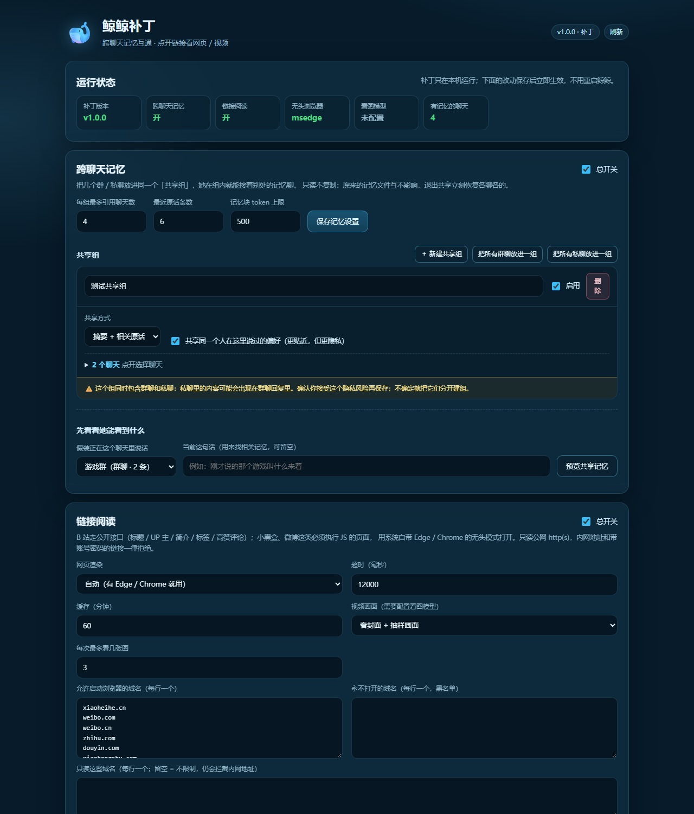

# 图文安装教程

> 先看这一句：**本补丁不能单独运行。**
> 必须先安装 **鲸鲸 / Whale Girl 4.0.x / 4.1.0**：<https://github.com/Banan1cee/whale_girl>
> 单独下载本仓库，双击任何文件都不会出现一个「AI 软件」——它只是给鲸鲸加功能的补丁。

---

## 0. 你需要准备什么

| 东西 | 说明 | 地址 |
| --- | --- | --- |
| 基础软件：鲸鲸 / Whale Girl 4.0.x / 4.1.0 | 带启动器、微信桥接、模型配置的完整软件 | <https://github.com/Banan1cee/whale_girl> |
| 本补丁 | 跨聊天记忆 + 链接阅读 | 本仓库的 **Releases / Code → Download ZIP** |
| Windows 10/11 | 补丁只支持 Windows | — |
| 可选：看图模型 Key | 想让 B 站链接「看封面/画面」才需要；不配也能用 | 在鲸鲸设置里配，默认智谱有免费额度 |

> 补丁**不自带**大模型、微信自动化、API Key。这些都在基础软件里配置。
>
> 装好后启动器左侧会多一栏 **「补丁」**；如果没看到（本体版本不匹配），
> 用网页控制台 `http://127.0.0.1:8787/patch/`，功能完全一样。

---

## 1. 先装好基础软件（鲸鲸）

1. 打开 <https://github.com/Banan1cee/whale_girl>；
2. 按它的 README / Releases 安装鲸鲸（4.0.8.2 或 4.1.0）；
3. 打开启动器，确认能：
   - 正常启动（状态页没有红色报错）；
   - 配置好一个模型（DeepSeek / 智谱 / Ollama 都行）；
   - 登录微信、桥接在线。

**先不要装补丁**，确认基础软件本身能正常聊天，再往下走。

---

## 2. 装补丁（3 步）

### 第 1 步：下载并解压

在本仓库页面点 **Code → Download ZIP**（或到 Releases 下载 `whale-girl-patch-vX.Y.Z.zip`），
解压到任意目录，例如：

```text
D:\Downloads\whale-girl-patch
```

> ⚠️ 不要在压缩包预览窗口里直接双击，必须先解压。

### 第 2 步：双击 `install.cmd`

打开解压后的文件夹，双击：

```text
install.cmd
```

会发生什么：

1. 弹出命令行窗口，依次显示 `1/6` … `6/6`；
2. 安装器自动寻找鲸鲸目录（注册表 / 运行中的启动器 / 常见路径）；
3. 找不到时会弹出一个**选择文件夹**的窗口：
   - 选**鲸鲸安装目录**，也就是包含 `server.js`、`src`、`runtime` 的那个文件夹；
   - 不要选补丁文件夹；
4. 如果本体是 4.0.8.2 或 4.1.0，最后一步会给启动器加一栏「补丁」（替换前自动备份）；
5. 询问 `Create desktop shortcuts (install/update + patch console)? [Y/n]`：
   - **Y**：桌面出现「鲸鲸补丁-安装或更新」「鲸鲸补丁-控制台」；
   - **n**：不创建，以后按「没有快捷方式怎么更新」操作；
6. 看到 `Installed successfully.` 就成功了。

安装器实际做这些事：

- 把 `patch\` 复制成 `鲸鲸目录\whale-patch\`；
- 在 `鲸鲸目录\server.js` 第一行加 `require('./whale-patch').install();`；
- 生成 `鲸鲸目录\data\whale-patch.json`；
- （可选）把启动器换成带「补丁」页的版本，备份为 `WhaleLauncher.exe.whale-patch.bak`；
- （可选）创建桌面快捷方式，指向你解压补丁的目录。

原 `server.js` 会备份为 `server.js.whale-patch.bak`。

### 第 3 步：重启鲸鲸

打开鲸鲸启动器：

1. 点「停止」（如果正在运行）；
2. **完全退出启动器**（托盘图标右键退出）——换了启动器文件，必须重开才会出现「补丁」栏；
3. 重新打开启动器，点「启动」；
4. 等状态页显示服务已启动。

> 补丁是在 `server.js` 启动时加载的，**不重启不会生效**。
> 只点「重启」通常只重启内核；要看到新的一栏，必须完整退出启动器再打开。
> 如果启动器提示端口被占用，先确认旧的鲸鲸进程已经退出。

---

## 3. 第一次打开补丁管理页

重启后，启动器左侧最后一项就是 **「补丁」**：

- 点开它，里面就是跨聊天记忆 / 链接阅读的控制台；
- 如果看不到这一栏（本体版本不匹配，或启动器没替换成功），用浏览器打开：

```text
http://127.0.0.1:8787/patch/
```

端口以启动器为准；如果改过端口，看 `鲸鲸目录\data\server-port.txt`。



页面从上到下：

1. **运行状态**：补丁版本、共享记忆开关、链接阅读开关、无头浏览器 / 看图模型是否可用；
2. **跨聊天记忆**：
   - 「把所有群聊放进一组」：群聊之间互通，不碰私聊（推荐先点这个）；
   - 「把所有私聊放进一组」：默认停用，确认隐私风险后再启用；
   - 「新建共享组」：自己勾选任意群 / 私聊；
   - 「预览共享记忆」：选一个聊天，看看她这一轮实际能看到什么；
3. **链接阅读**：开关、超时、缓存、浏览器域名白名单；
4. **试读一个链接**：填 B 站 / 小黑盒 URL，点「读取」，能看到模型实际收到的文字。

改完记得点对应的「保存」按钮。保存后下一轮聊天生效，**不用再重启**。

---

## 4. 怎么验证真的生效了

### 4.1 链接阅读

在管理页「试读一个链接」里填：

```text
https://www.bilibili.com/video/BV1GJ411x7h7
```

点「读取」，正常情况下会看到：

- 标题、UP 主、时长、播放/点赞；
- 标签、高赞评论；
- 「你点开后看了封面和几张视频画面，看到的是：…」

然后在微信里给鲸鲸发一个 B 站链接，她应该能接一句和视频内容相关的话，而不是「我看不到链接」。

### 4.2 跨聊天记忆

1. 到「跨聊天记忆」点「把所有群聊放进一组」并保存；
2. 在 A 群聊一件事（例如「我最近在玩艾尔登法环」）；
3. 到 B 群问她「我之前说的那个游戏叫什么？」；
4. 她应该能接上 A 群的记忆。

如果你只有**一个**群，群聊共享暂时看不出效果；可以：
- 再拉一个群 / 用小号建测试群；
- 或新建自定义共享组，把某个私聊和群放一起（页面会弹隐私警告，确认后再保存）。

---

## 5. 常见问题

### 双击后 Windows 提示「未知发布者 / 已保护你的电脑」

- 这个补丁是第三方开源补丁，没有商业代码签名；
- 点「更多信息」→「仍要运行」；
- 不放心可以先看仓库源码：`install.ps1`、`patch\`、`launcher\launcher.patch` 都是明文。

### 打开 `/patch/` 是 404

- 没有重启鲸鲸 → 停止 → 启动；
- 启动的是旧进程 → 看启动器状态，或任务管理器结束旧的 `node.exe` 后重开；
- 端口不是 8787 → 看 `data\server-port.txt`，用那个端口；
- 补丁没装上 → 在鲸鲸目录运行：
  `runtime\node.exe whale-patch\cli.js doctor`，看「启动挂钩」是否 ✅。

### 安装器说找不到鲸鲸

在弹窗里手动选**包含 `server.js` 的文件夹**。如果选错，重跑 `install.cmd` 即可。

### 安装器报 `server.js syntax check failed`

说明 `server.js` 被改坏了。把同目录的 `server.js.whale-patch.bak` 复制回 `server.js`，再重装。

### 小黑盒链接读不到正文

- 小黑盒 / 微博这类站点有风控，连续请求会要求人机验证；
- 鲸鲸以**管理员权限**运行时，Edge 无头模式在部分机器上返回空页面；
- 补丁会明确告诉模型「没读到正文」，只根据分享卡片的标题/简介接话，**不会编造内容**；
- B 站、普通网页/公众号不受影响。

### 看图模型显示「未配置」

到鲸鲸启动器「设置 → 看图」里配一个视觉模型 Key（默认智谱 `glm-4.6v-flash` 有免费额度）。
不配也能读文字，只是不看封面/视频画面。

### 共享记忆没效果

- 总开关没开；
- 聊天不在任何启用中的共享组里；
- 组里其它聊天还没有摘要 / 原话（新聊天要聊几句）；
- 只有一个群 → 群聊组内没有「别的群」可引用。

### 想改端口 / 远程访问

补丁管理页只允许本机访问，这是故意的：它能读记忆、改共享组。不要把 `/patch/` 暴露到公网。

---

## 6. 鲸鲸本体更新后

鲸鲸更新可能覆盖两样东西：

- `server.js` 第一行的补丁挂钩；
- `WhaleLauncher.exe`（带「补丁」页的启动器）。

处理办法：**更新完本体后，重新双击一次 `install.cmd`**。

- 补丁会重新加挂钩、重新装「补丁」页（仅当补丁仓库有对应新版本的启动器构建）；
- `data\whale-patch.json`、聊天记忆、共享组配置都不会丢；
- 如果新本体还没有对应的启动器构建，安装器会跳过启动器，网页控制台仍然可用。

补丁版本与适配说明见 [docs/updates.md](updates.md)。

### 有快捷方式

双击桌面 **「鲸鲸补丁-安装或更新」** → 等 `Installed successfully` → 完全退出启动器再打开。

### 没有快捷方式

1. 打开 <https://github.com/7ather-LX/whale-girl-patch/releases/latest>；
2. 下载最新 `whale-girl-patch-vX.Y.Z.zip`；
3. 解压到固定目录（例如 `D:\WhaleGirlPatch`）；
4. 双击解压目录里的 `install.cmd`；
5. 完全退出启动器再打开 → 点「启动」。

> 快捷方式指向你当初解压补丁的文件夹；删了它快捷方式就会失效。
> 重新下载 ZIP 解压、运行 `install.cmd`，安装器会重新创建快捷方式。

---

## 7. 卸载

双击解压目录里的 `uninstall.cmd`：

- 删除 `鲸鲸目录\whale-patch\`；
- 删除 `server.js` 第一行的加载语句；
- 默认保留 `data\whale-patch.json`（下次装回来配置还在）。

想连配置和缓存一起删：

```powershell
powershell -ExecutionPolicy Bypass -File .\uninstall.ps1 -PurgeData
```

想用安装时的备份还原 `server.js`：

```powershell
powershell -ExecutionPolicy Bypass -File .\uninstall.ps1 -RestoreBackup
```

卸载后重启鲸鲸，补丁功能完全消失，鲸鲸恢复原样。

---

## 8. 安全说明

- 补丁只在本机运行；管理页只监听 `127.0.0.1`；
- 链接由本机直接访问目标站，不经过第三方中转；
- 不读取浏览器 Cookie；无头浏览器每次用全新临时 profile，跑完删除；
- 内网 / 本机 / 云元数据地址、带账号密码的 URL 一律拒绝；
- 记忆共享是**本机文件之间**的读取，不联网；关掉开关立即失效。

---

## 9. 许可

本补丁是鲸鲸的修改版，遵循 **AGPL-3.0-only**。
分发或通过网络提供修改版时，请保留 `LICENSE`、`NOTICE.md`，并注明：

> 基于鲸鲸 / Whale Girl（作者 @Banan1cee，https://github.com/Banan1cee/whale_girl）修改。
